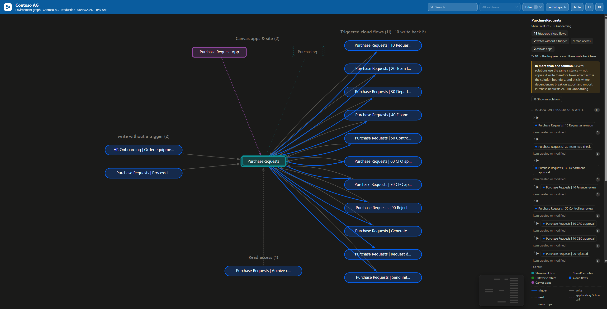
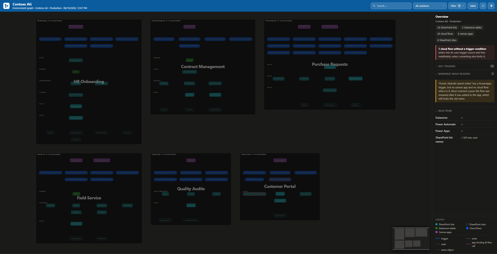
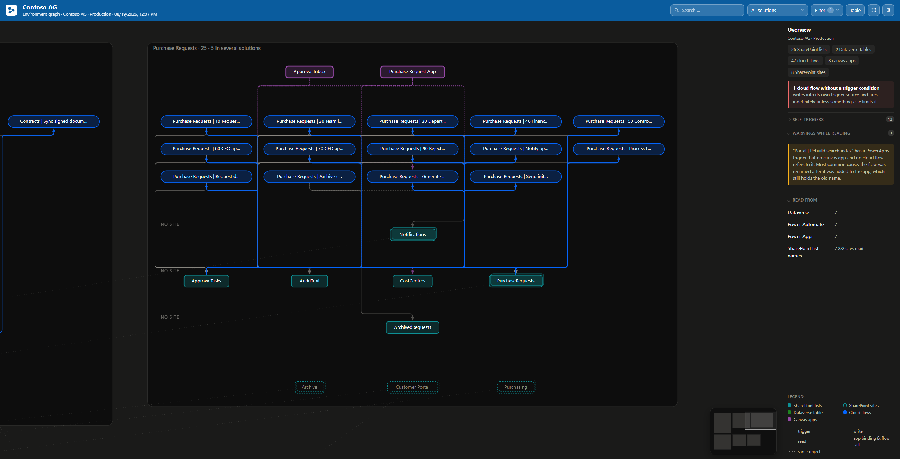

# ppgraph

**See what is wired to what in a Power Platform environment.**

A grown environment is a web nobody can see. SharePoint lists trigger Power Automate cloud flows;
those flows write back into other lists and into Dataverse tables, which trigger the next flows;
Power Apps canvas apps sit on top, binding some of it and calling the rest. None of that is written
down anywhere — the only way to find out what a change touches is to open every flow, one at a time,
and read its trigger and its actions.

ppgraph reads the whole environment once and turns it into a report that answers the questions you
otherwise cannot:

- **What happens if I write here?** Every flow that a create, update or delete on a list sets off —
  with the conditions that decide whether it really fires, and what those flows set off in turn.
  The question to ask before a bulk edit, an import or a data cleanup.
- **What breaks if I rename or delete this?** Everything that depends on a given list, flow or app.
- **Why did that flow run?** What can start it — a list, an app, a parent flow — and under which
  condition.
- **What is already broken?** Flows that trigger on a list they write to themselves without a guard
  (endless loops waiting to happen), lists whose environment variable points at nothing, flows
  nothing calls any more, disabled flows.
- **What runs here at all?** For an environment you took over rather than built.

You get one interactive diagram for people, three Markdown files and a JSON graph for tools — and an
MCP server, so an AI agent can ask these questions directly instead of reading files.

Needs **Node 18 or newer**. Nothing else: no Azure CLI, no PowerShell, no app registration — it
signs itself in through your browser.

---

## Quick start

### As a command-line tool

```bash
npx ppgraph
```

It asks which environment to read, where to put the report, and in which language — then opens your
browser once to sign in. Everything can be given up front instead:

```bash
npx ppgraph --environment "Production" --out ./reports/contoso --open
```

### As an MCP server

Add this to your agent's MCP configuration (`.mcp.json`, `claude_desktop_config.json`, …):

```json
{
  "mcpServers": {
    "ppgraph": {
      "type": "stdio",
      "command": "npx",
      "args": ["-y", "ppgraph", "mcp", "--reports", "reports/{tenant}/{environment}"]
    }
  }
}
```

Your agent can now ask questions instead of reading files:

> *"What happens if I write to the Orders list?"*
> *"Which flows have no caller?"*
> *"Build a fresh report for the production environment."*

---

## What it looks like

Select any list and the report answers the question directly: which flows a write starts, which of
them write back, and what that sets off in turn.



<table>
<tr>
<td><a href="examples/screenshot-overview.png"></a></td>
<td><a href="examples/screenshot-solution.png"></a></td>
</tr>
<tr>
<td>The whole environment — one frame per solution</td>
<td>One solution up close</td>
</tr>
</table>

The report shown is generated from a fictional environment (six solutions, 42 flows, 26 lists, eight
apps) and lives in [`examples/sample-report/`](examples/sample-report/) — open `graph.html` in any
browser, no server and no network needed. Rebuild it with `node scripts/sample-report.mjs`.

---

## What you get

One directory with five files:

| File | For | What it is |
|---|---|---|
| `graph.html` | **people** | interactive diagram — opens in any browser, works offline, in your language |
| `graph-index.md` | agents | the entry point: what is in this environment, and where the rest is |
| `graph.md` | agents | the digest — trigger map, cascades, self-triggers |
| `graph-flows.md` | agents | one section per cloud flow |
| `graph.json` | tools | the complete graph as data |

Every file records the exact command that produced it, so refreshing a report never needs guesswork.

---

## The MCP tools

| Tool | Answers |
|---|---|
| `graph_find` | a name → a node. **The entry point for everything else** |
| `graph_impact` | what a write to this list sets off, with conditions and follow-on flows |
| `graph_node` | one thing in full: trigger, conditions, connectors, every read and write |
| `graph_findings` | self-triggers, unresolved references, flows nothing calls, disabled flows |
| `graph_overview` | what is in this environment: counts, solutions, findings |
| `graph_reports` | which reports this server can read |
| `graph_build` | read an environment and write a fresh report |
| `graph_open` | open `graph.html` for a person |

Answers are capped at 24 kB and say what they left out, so no single call floods your agent's
context. Each one names the report it came from and how old it is.

### Where reports are stored

| | |
|---|---|
| `--reports "<template>"` | where a build lands. Placeholders: `{tenant}`, `{environment}`, `{label}` |
| `--root <path>` | an additional place to look for existing reports; repeatable |
| `--allow-any-out` | let a tool write outside those locations (off by default) |

Without `--reports`, reports go to `<user data dir>/ppgraph/reports/{tenant}/{environment}`. A
relative template is relative to the server's working directory.

---

## CLI options

Nothing is required — anything you leave out is discovered or asked for.

**Which environment**

| Option | |
|---|---|
| `--environment <name\|guid>` | environment to read (alias `--env`) |
| `--tenant <domain\|guid>` | Entra tenant to sign in to |
| `--dataverse-url <url>` | Dataverse organisation URL; discovered when omitted |
| `--account <upn>` | account to suggest at the sign-in prompt |
| `--list-environments` | list what this account can see, then exit |

**What to read**

| Option | |
|---|---|
| `--solution <a,b>` | report only these solutions; repeatable |
| `--skip <a,b,c>` | leave collectors out: `powerapps`, `powerautomate`, `dataverse`, `solutions`, `variables`, `sharepoint` |
| `--no-sharepoint` | shorthand for `--skip sharepoint` — much faster, but lists keep their IDs |
| `--refresh-names` | discard the cached SharePoint list names |

**Output**

| Option | |
|---|---|
| `--out <path>` | target directory |
| `--locale <de\|en>` | language of `graph.html` (default `de`); the other files are always English |
| `--label <text>` | what the report calls this tenant |
| `--site-name <url>=<name>` | a friendlier name for one site; repeatable |
| `--open` | open the report when finished |
| `--quiet`, `--no-color` | results and errors only / no colour |

**Branding** — optional; without them the report looks plain.

| Option | |
|---|---|
| `--brand-title <text>` | shown in the report's header band |
| `--brand-logo <path\|url>` | image for that band; inlined, so the file stays self-contained |
| `--brand-color <#rrggbb>` | the band colour. Not applied to nodes — those colours are the technology key |

**Sign-in**

| Option | |
|---|---|
| `--logout` | forget the stored sign-in; `--tenant` narrows it to one |
| `--sharepoint-client-id <id>` | application to sign in with for SharePoint, when the default is refused |
| `--no-sharepoint-login` | never open a browser for SharePoint; lists may keep their IDs |

---

## Signing in

ppgraph holds its own tokens — it does not use or affect any other tool's sign-in.

A machine that has never run it against a tenant opens **up to two browser windows**: one for Power
Platform, one for SharePoint. After that, none, until a token expires. Tokens live in
`<user data dir>/ppgraph/tokens.json`, readable only by you.

Both sign-ins use Microsoft first-party applications that are already registered in every tenant, so
**nothing has to be registered and no admin has to be involved**. A tenant that refuses the
SharePoint one can supply its own through `--sharepoint-client-id`.

---

## Environment variables

| | |
|---|---|
| `PPGRAPH_HOME` | where tokens and default report locations live |
| `PPGRAPH_REPORTS` | the report template, same as `--reports` |
| `PPGRAPH_NO_BROWSER` | never open a browser; the device-code sign-in still works |

---

## Reading a report

The diagram is meant to be self-explanatory: each frame is one solution, the colour is the
technology — cloud flows blue, canvas apps purple, SharePoint teal, Dataverse green — and the filter
at the top reduces everything to one solution. Click anything to see what it deals with.

**If you read the files instead of asking the tools**, they are four sizes rather than four views:
`graph-index.md` is the entry point and is meant to be read whole; `graph.md` and
`graph-flows.md` are large and meant to be searched, never read; `graph.json` is a database, meant
to be queried. Filter it on machine values — `state`, `on`, `kind`, `verb`, `resolved` — never on
the wording beside them.

---

## License

[GNU AGPL v3](LICENSE) or later. ppgraph is free software: use it, change it, share it.
If you build on it and pass your work on — including by running a modified version as a network
service — that work has to be free software too.

Copyright (C) 2026 Simon Gander
